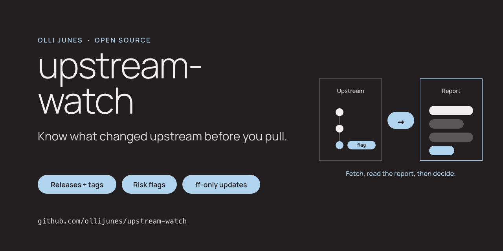

# upstream-watch



[](https://github.com/ollijunes/upstream-watch/actions/workflows/ci.yml)
[](pyproject.toml)
[](LICENSE)

Watch the public GitHub repositories you have cloned but do not own. Fetch
without touching your working tree, read what changed, and pull only when
you have decided to.

Most of us have a folder of clones: tools we build from source, libraries we
read, dotfile collections we borrow from. We `git pull` them now and then
without looking. upstream-watch looks first. It fetches, compares with the
last check and writes a Markdown report: new releases, tags and commits, a
condensed changelog, and flags for the things worth a second look, such as a
force-push, a moved tag, an unsigned tag after signed ones, a possible new
maintainer, or a changed install script. Updates happen only with
`git pull --ff-only`, only after you approve, or for repositories you have
allowlisted.

[Flags](docs/flags.md) · [Example report](examples/report.md) ·
[Security](SECURITY.md) · [Contributing](CONTRIBUTING.md) ·
[ollijunes.com](https://ollijunes.com)

## Who it is for

People who keep clones of other people's public repositories on their own
machine and want to know what is coming before they update, on macOS or
Linux. It is not for repositories you own; those are skipped on purpose.

## Install

You need Python 3.11+ and Git. The `gh` CLI is optional; when it is logged
in, its token raises the GitHub API limit and enables tag verification.

```sh
uv tool install git+https://github.com/ollijunes/upstream-watch
upstream-watch --version
```

`pipx install git+https://github.com/ollijunes/upstream-watch` works too.

## Set up

```sh
upstream-watch init --own YOUR-GITHUB-NAME --root ~/src
upstream-watch list
```

`--own` takes the GitHub users and organisations whose repositories are
yours. Clones of those are never watched, also when they are the `origin`
of a fork you made; the fork's `upstream` remote is watched instead.
`--root` takes the folders to search, four levels deep by default. The
config goes to `~/.config/upstream-watch/config.toml`.

`list` prints every clone it found with the reason it is watched or
skipped: `own`, `not-github`, `excluded`, `no-remote`, `worktree-duplicate`,
`not-public`, `not-a-repo-root`, `symlink` or `invalid-remote-name`. A path
must be the top level of a clone, not a folder inside one, and no part of
the path may be a symlink. You can also pass a file of paths with `--from`
instead of searching.

## Check

```sh
upstream-watch check
```

The first check records a baseline for each repository and flags nothing
except an archived or transferred repository. Later checks compare with the
baseline and print one line per repository, then the path of the report.
Reports go to `~/.local/state/upstream-watch/reports/`, one file per run,
never overwritten. Use `--stdout` to print the report instead, or
`--report PATH` to choose the file. Only one check or update runs at a
time; a second one says so and exits.

The report starts with a table and the flags, then one section per
repository with releases, tags, a changelog grouped by commit type, and the
state of your local branch. [examples/report.md](examples/report.md) shows
one from the test fixtures.

A check runs `git fetch` with explicit refspecs: branches go to the usual
`refs/remotes/<remote>/`, tags go to a namespace owned by the tool, so your
local tags and branches are never written, whatever your clone's fetch
configuration says. Git hooks, `fsmonitor` and automatic maintenance are
turned off for every command the tool runs. A check never runs `pull`,
`merge` or `checkout`; the one exception is `check --update-allowed`,
described below.

Flags stay pending until your clone has caught up with the remote or an
update succeeds. A force-push you have not acted on is still in the next
report and still blocks `update`.

The exit code tells a script what it found, in this order: 2 when every
repository failed to fetch, 20 when a `high` flag is pending, 10 when a
`review` flag is pending, 1 when a check or an update failed, 0 otherwise.
`info` flags do not change the exit code.

## Flags

| Severity | Flag |
| --- | --- |
| high | Force-push: the previous tip is no longer an ancestor of the new one |
| high | A known tag now points at a different commit |
| high | The repository was transferred or renamed |
| review | Default branch changed |
| review | A new tag is unsigned although earlier tags were signed, or GitHub cannot verify it although earlier tags were verified |
| review | New maintainer signal: new author or committer identities wrote a large share of the new commits, touched install or build files, or tagged a release |
| review | Ownership files changed: `CODEOWNERS`, `MAINTAINERS`, `SECURITY.md` and similar |
| review | Install, build or CI files changed: install scripts, `Makefile`, `pyproject.toml`, `package.json` lifecycle scripts, `Dockerfile`, workflows and more |
| review | New executable or binary files, or an added line that pipes a download into a shell |
| info | Archived, a fork with a parent, a shallow clone, a detached HEAD |

[docs/flags.md](docs/flags.md) explains each flag, how it is detected and
what to do about it. A flag is a reason to read the diff, not proof of
anything.

## Update

```sh
upstream-watch update            # asks per repository
upstream-watch update ~/src/tool --dry-run
```

`update` fast-forwards a repository to the exact commit the last check
looked at, with `git merge --ff-only <commit>`. It does not fetch again, so
nothing you have not seen in a report can come in. It refuses when any of
these is true: no check in the last 24 hours, the remote moved since the
check, the clone is not on the branch that tracks the watched default
branch, the working tree or index is not clean, a merge, rebase,
cherry-pick or bisect is in progress, the local branch is ahead, a `high`
flag is pending, or the last check could not analyse the whole range. Every
condition is checked again right before the merge, also with `--yes`. It
never falls back to a merge commit or a rebase.

Without a terminal nothing is updated unless you pass `--yes`. Repositories
listed in `auto_update` in the config are updated without asking, also by a
scheduled `check --update-allowed`, unless a flag listed in
`auto_update_blocked_by` is present. The default blocks on `high`.

## Schedule

```sh
upstream-watch schedule install --at 08:00
upstream-watch schedule install --at 08:00 --weekday 1   # Mondays
```

On macOS this writes a launchd agent to `~/Library/LaunchAgents/` and loads
it. A run missed while the Mac sleeps happens at the next wake. macOS shows a
"Background item added" notice the first time. Logs go to
`~/Library/Logs/upstream-watch/`. Add `--update-allowed` to let the scheduled
check update your `auto_update` repositories.

`schedule print` shows the file without installing it, and
`schedule print --platform systemd` prints a user service and timer for
Linux. The same templates are in [`contrib/`](contrib).

A scheduled fetch over SSH needs a running agent. The launchd agent runs in
your login session, so the macOS SSH agent and Keychain work. HTTPS remotes
without credentials work everywhere.

## Configuration

```toml
own = ["me-example", "my-org"]       # never watched
roots = ["~/src"]                    # folders to search
max_depth = 4
repos = []                           # extra clone paths outside the roots
exclude = []                         # paths or globs never watched
auto_update = []                     # paths or owner/repo that may update without asking
auto_update_blocked_by = ["high"]
github_api = true                    # false: git-only, no releases or verification
```

The GitHub API is used for repository metadata, releases and tag
verification. Without a token the tool makes at most two calls per
repository per run and stops calling the API for the rest of the run when
the rate limit is reached; git-based checks continue. A token comes from
`GITHUB_TOKEN` or from `gh auth token --hostname github.com`, is sent to
`https://api.github.com` only, and is never printed or written.

## How it compares

[myrepos](https://myrepos.branchable.com) and [gita](https://github.com/nosarthur/gita)
run Git commands across many repositories. They answer "update everything"
well. upstream-watch answers a different question: what changed in the
repositories I depend on, and is it safe to pull?

| | myrepos | gita | upstream-watch |
| --- | --- | --- | --- |
| Finds clones by itself | No, `mr register` per repo | `gita add -a` under a folder | Searches your roots and skips your own repositories |
| Default action | `mr update` pulls | `gita pull` merges | Fetch only; nothing touches your working tree |
| New releases and tags since last check | No | No | Yes |
| Condensed changelog of what is coming | No | No | Yes, grouped by commit type |
| Force-push and moved tags | No | No | Flagged as high |
| Unsigned tag after signed ones | No | No | Flagged for review |
| New maintainer signal, changed install scripts, build hooks or CI | No | No | Flagged for review |
| Update policy | Any command you configure | Merge or rebase per Git config | `git pull --ff-only` only, after approval or per-repo allowlist |
| Other version control systems | Yes | No | No, Git and GitHub only |

If you want one command to pull fifty repositories, use myrepos or gita.
upstream-watch is for the clones you read before you update, such as tools
you run with your own credentials or code you build from source.

## Limitations

- GitHub only. Clones from GitLab, Codeberg or a self-hosted server are
  listed as `not-github` and skipped. SSH host aliases from `~/.ssh/config`
  are not resolved, so a remote like `github-work:owner/repo` is skipped too.
- Signatures are not verified locally. The tool sees whether a tag carries a
  signature block and, with a token, what GitHub says about it. It does not
  check keys.
- The maintainer signal is a heuristic based on hashed author and committer
  emails. A new contributor with a large pull request looks the same as a
  new maintainer. Read the diff.
- A changed `package.json` is flagged only when its lifecycle scripts
  change. Other manifests are flagged on any change.
- The changelog shows up to 30 non-merge subjects and 10 merge subjects per
  check. Very large diffs and tag lists are cut, and the report then says
  the analysis was incomplete; such a repository is not auto-updated.
- The download-to-shell check is text matching on added lines. It misses
  constructions it does not know and can match an example in a README.
- The scheduled install is launchd only. Linux users install the printed
  systemd units by hand.

## Development

```sh
uv sync --locked
uv run python -m pytest --cov=upstream_watch --cov-fail-under=90
uv run ruff check .
uv run ruff format --check .
python3 scripts/check_public_tree.py
```

The tests build upstream repositories and clones under a temporary
directory and talk to a local fake GitHub API. No test reaches the network
or reads a real clone.

## License

[MIT](LICENSE). Made by [Olli Junes](https://ollijunes.com). Not affiliated
with GitHub.
